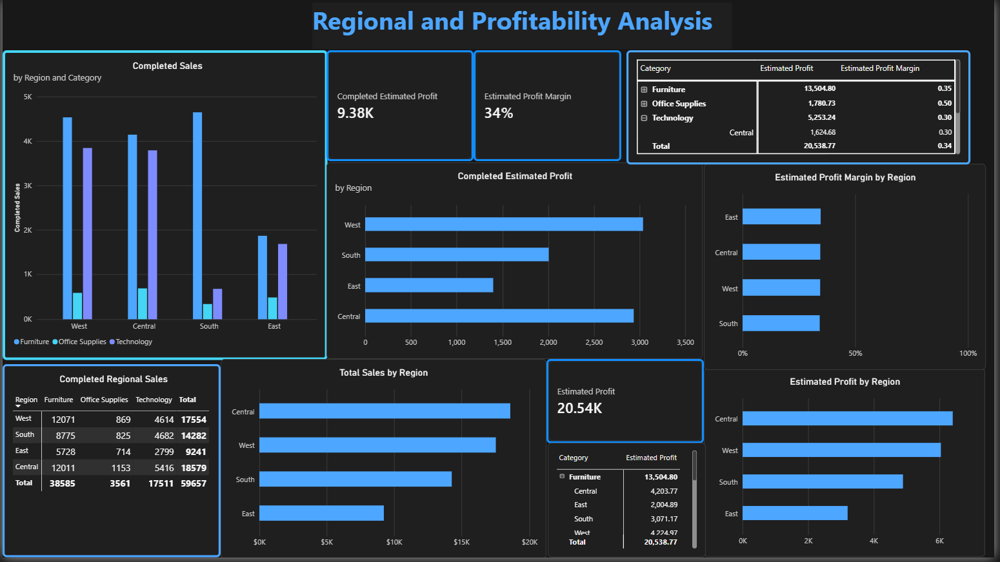

# sales-performance-analysis
Power BI Sales Performance and Profitability Analysis
Project Overview
## Dashboard Preview

### Sales Overview

### Regional Profitability Analysis

This project examines 200 sales transactions using Microsoft Power BI to assess sales performance, regional trends, product category results, and estimated profitability. The objective is to uncover actionable business insights and support data-driven decision-making.

Tools and Technologies:
- Microsoft Power BI
- DAX (Data Analysis Expressions)
- CSV Dataset
- Key Performance Indicators (KPIs)
- Total Sales
- Total Orders
- Completed Sales
- Completed Orders
- Average Completed Order Value
- Order Completion Rate
- Estimated Profit
- Estimated Profit Margin

Key Findings:
- The West region generated the highest completed sales, totaling $8,972.34.
- The Central region recorded the highest number of completed orders with 33 transactions.
- Furniture produced the highest estimated profit at $13,504.80.
- Office Supplies achieved the highest estimated profit margin at 50%.
- Technology recorded the lowest estimated profit margin at 30%.

Key Business Insights:
- Regional performance: West generated the highest completed sales at $8,972.34.
- Order completion: Only 56.5% of orders were completed, indicating an opportunity to investigate pending and returned orders.
- Category profitability: Furniture generated the highest estimated profit at $13,504.80.
- Profit margins: Office Supplies had the highest estimated profit margin at 50%, while Technology had the lowest at 30%.

## Business Recommendations
- **Improve order completion:** Investigate why 43.5% of orders were not completed. Separate pending orders from returned orders to identify potential causes.
- **Protect Furniture profitability:** Continue monitoring Furniture sales and estimated profit because it contributes the most estimated profit.
- **Review Technology margins:** Investigate product costs, pricing, and discounts to understand its lower estimated profit margin.
- **Optimize regional performance:** Investigate why East and South have lower completed sales than West and Central.

Profitability Assumptions:
Estimated profitability was calculated using category-specific cost assumptions for analytical purposes:

Category | Estimated Cost (% of Sales) | Estimated Profit Margin
--- | ---: | ---:
Technology | 70% | 30%
Furniture | 65% | 35%
Office Supplies | 50% | 50%

Note: These assumptions were created for demonstration purposes and do not represent actual company cost data. Therefore, all profit and margin calculations should be considered estimates.

Project Limitations

The dataset includes only 200 sales records and does not contain actual cost data, customer satisfaction metrics, or detailed inventory information. Additional data sources would be required to perform a more comprehensive profitability and operational analysis.

Conclusion

This analysis demonstrates how Power BI can transform raw sales data into meaningful business intelligence. By visualizing sales performance, regional trends, and estimated profitability, the project provides valuable insights that can support strategic decisions related to pricing, inventory management, marketing initiatives, and overall business growth.
